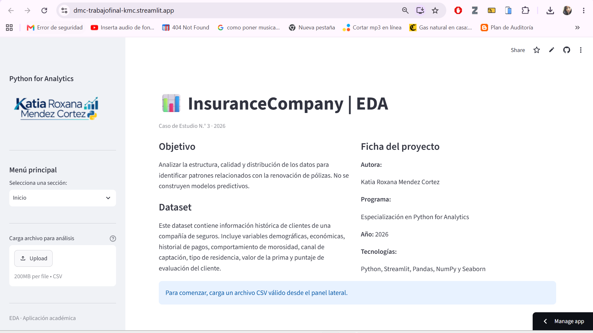
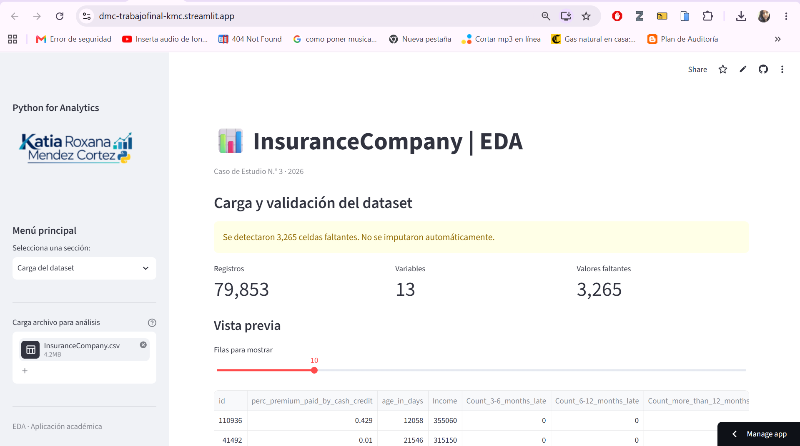
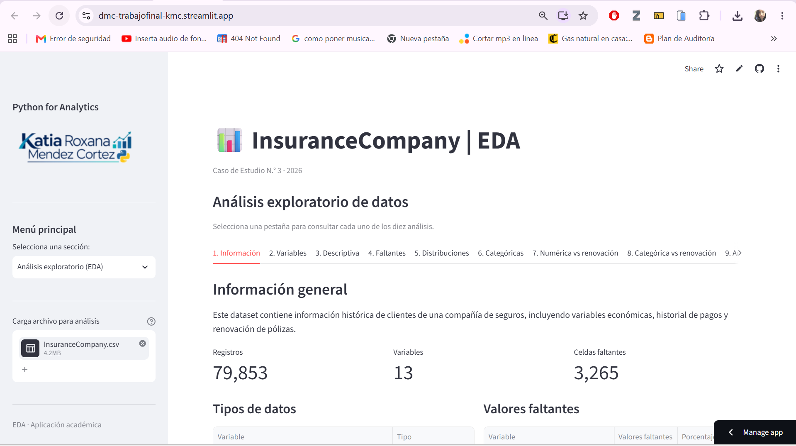
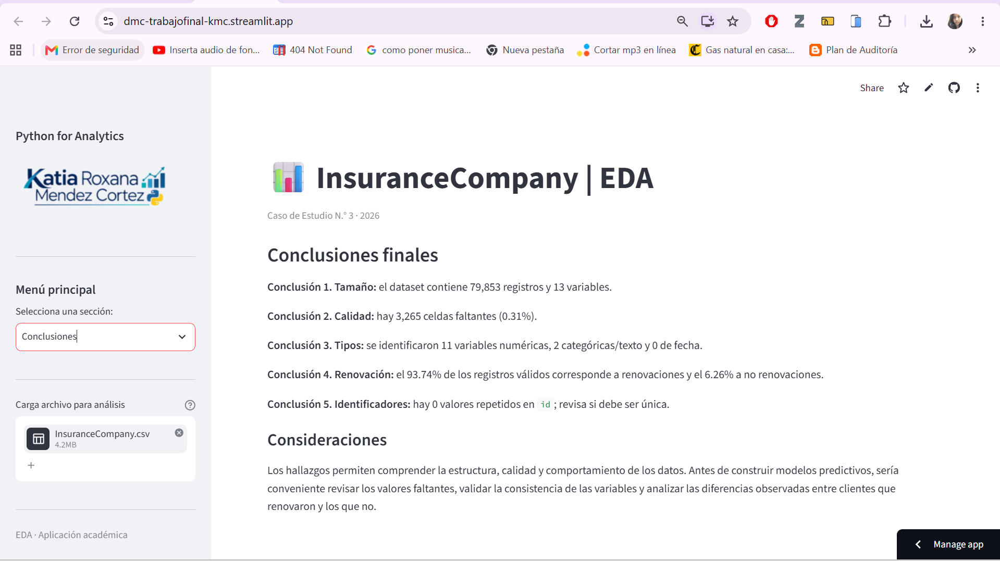

# InsuranceCompany | EDA

**Aplicación interactiva de análisis exploratorio de datos para una compañía de seguros**

[](https://dmc-trabajofinal-kmc.streamlit.app/)
[](https://github.com/KatiaMendez/DMC-TrabajoFinal)

---

## 1. Descripción del proyecto

**InsuranceCompany | EDA** es una aplicación web desarrollada con Python y Streamlit como parte del Caso de Estudio N.° 3 de la especialización Python for Analytics.

El objetivo del proyecto es realizar un análisis exploratorio de datos (Exploratory Data Analysis — EDA) de una cartera de clientes de una compañía de seguros, con el propósito de comprender las características del conjunto de datos, evaluar su calidad, identificar patrones y explorar posibles relaciones entre las variables y la renovación de pólizas.

La aplicación permite interactuar con los datos mediante tablas, indicadores y visualizaciones, facilitando la interpretación de la información sin necesidad de conocimientos avanzados de programación.

### Funcionalidades principales

- **Presentación del proyecto:** descripción del objetivo, contexto y características generales del dataset.
- **Carga de datos:** importación de archivos CSV y visualización de una muestra de los registros.
- **Validación de datos:** revisión de la estructura del archivo, columnas, tipos de datos y valores faltantes.
- **Análisis exploratorio:** consulta de estadísticas descriptivas, distribuciones y comportamiento de las variables.
- **Análisis de variables categóricas:** exploración de frecuencias y proporciones.
- **Análisis de relaciones:** evaluación de asociaciones entre variables y su posible relación con la renovación de pólizas.
- **Visualizaciones:** representación gráfica de los datos para facilitar la identificación de patrones.
- **Resumen de hallazgos:** presentación de resultados relevantes para comprender el comportamiento de los clientes.
- **Conclusiones:** síntesis de los principales resultados del análisis.

La aplicación está orientada al análisis descriptivo y exploratorio; no tiene como objetivo entrenar ni desplegar modelos predictivos.

## 2. Capturas de la aplicación

La aplicación se encuentra publicada y puede utilizarse directamente desde el navegador.

**Enlace:** [InsuranceCompany | EDA — Aplicación en Streamlit](https://dmc-trabajofinal-kmc.streamlit.app/)

### 2.1. Pantalla de inicio

Presenta el proyecto, su objetivo y la información general necesaria para orientar al usuario.



### 2.2. Carga y validación del dataset

Permite cargar el archivo CSV, visualizar los registros y revisar la estructura general de los datos.



### 2.3. Análisis exploratorio de datos

Contiene las opciones de análisis y las visualizaciones que permiten examinar la distribución de las variables, sus características y las relaciones entre ellas.



### 2.4. Hallazgos y conclusiones

Presenta un resumen de los resultados identificados durante el análisis exploratorio, incluyendo el comportamiento de la variable de renovación cuando se encuentra disponible.



## 3. Instrucciones de ejecución

La aplicación puede utilizarse desde la versión publicada en Streamlit o ejecutarse localmente.

### 3.1. Requisitos previos

Para ejecutar el proyecto localmente, se requiere:

- Python instalado.
- Git, para clonar el repositorio.
- Los archivos del proyecto.
- Las librerías indicadas en `requirements.txt`.

### 3.2. Clonar el repositorio

Abre una terminal y ejecuta:

```bash
git clone https://github.com/KatiaMendez/DMC-TrabajoFinal.git
```

Luego, ingresa a la carpeta del proyecto:

```bash
cd DMC-TrabajoFinal
```

### 3.3. Crear un entorno virtual

Se recomienda crear un entorno virtual para mantener aisladas las dependencias del proyecto.

En Windows, utilizando PowerShell:

```powershell
python -m venv .venv
.\.venv\Scripts\Activate.ps1
```

En macOS o Linux:

```bash
python3 -m venv .venv
source .venv/bin/activate
```

### 3.4. Instalar las dependencias

Ejecuta el siguiente comando desde la carpeta del proyecto:

```bash
pip install -r requirements.txt
```

Este comando instala las librerías necesarias para ejecutar la aplicación.

### 3.5. Ejecutar la aplicación

Inicia Streamlit mediante el siguiente comando:

```bash
streamlit run app.py
```

Una vez iniciada la aplicación, abre en tu navegador la dirección local que aparece en la terminal. Normalmente, será:

```text
http://localhost:8501
```

### 3.6. Utilizar la aplicación publicada

Si prefieres no instalar Python ni las dependencias, puedes acceder directamente desde el siguiente enlace:

[https://dmc-trabajofinal-kmc.streamlit.app/](https://dmc-trabajofinal-kmc.streamlit.app/)

Desde la interfaz podrás navegar por las secciones disponibles, cargar un archivo CSV compatible y consultar los resultados del análisis.

## 4. Estructura del proyecto

La estructura principal del repositorio es la siguiente:

```text
DMC-TrabajoFinal/
│
├── app.py
├── requirements.txt
├── InsuranceCompany.csv
├── README.md
│
└── screenshots/
    ├── Inicio.png
    ├── Carga.png
    ├── Analisis.png
    └── Conclusiones.png
```

**Descripción de los archivos:**

- `app.py`: contiene el código fuente de la aplicación desarrollada con Streamlit.
- `requirements.txt`: especifica las dependencias necesarias para ejecutar el proyecto.
- `InsuranceCompany.csv`: contiene el conjunto de datos utilizado para realizar el análisis exploratorio.
- `README.md`: presenta la documentación del proyecto.
- `screenshots/`: contiene las capturas de pantalla utilizadas para ilustrar las funcionalidades de la aplicación.

La carpeta `screenshots/` debe crearse si aún no existe.

## 5. Tecnologías utilizadas

| Tecnología | Aplicación en el proyecto |
|---|---|
| Python | Desarrollo de la lógica de la aplicación y análisis de datos. |
| Streamlit | Construcción de la interfaz web interactiva. |
| Pandas | Lectura, transformación y análisis de los datos. |
| NumPy | Operaciones numéricas y procesamiento de información. |
| Matplotlib | Generación de gráficos y visualizaciones. |
| Seaborn | Elaboración de visualizaciones estadísticas. |
| GitHub | Control de versiones y almacenamiento del código fuente. |
| Streamlit Community Cloud | Publicación y acceso web a la aplicación. |

## 6. Links relevantes

- **Aplicación web:** [InsuranceCompany | EDA](https://dmc-trabajofinal-kmc.streamlit.app/)
- **Repositorio del proyecto:** [DMC-TrabajoFinal en GitHub](https://github.com/KatiaMendez/DMC-TrabajoFinal)
- **Código fuente:** [app.py](https://github.com/KatiaMendez/DMC-TrabajoFinal/blob/main/app.py)
- **Dataset:** [InsuranceCompany.csv](https://github.com/KatiaMendez/DMC-TrabajoFinal/blob/main/InsuranceCompany.csv)
- **Dependencias:** [requirements.txt](https://github.com/KatiaMendez/DMC-TrabajoFinal/blob/main/requirements.txt)

## 7. Autora

**Katia Roxana Mendez Cortez**

Especialización en Python for Analytics  
2026

---

*Proyecto académico orientado al análisis exploratorio de datos y al desarrollo de aplicaciones interactivas para la exploración y visualización de información.*
